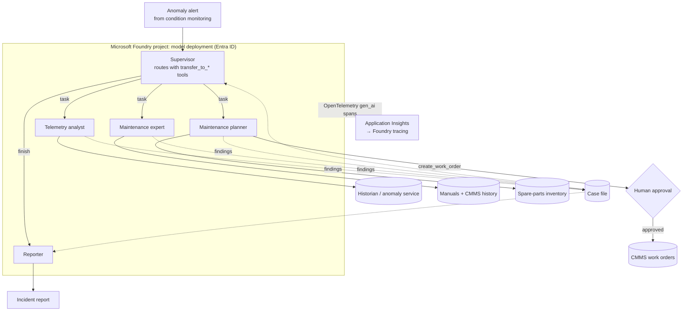

# Multi-Agent Incident Triage on Microsoft Foundry

[](https://github.com/Isaac19911369/multi-agent-azure-foundry/actions/workflows/ci.yml)


This is a production-style **multi-agent system** that triages an industrial equipment alarm the way a reliability team would:

1. Quantify the sensor evidence.
2. Diagnose the root cause from manuals and maintenance history.
3. Check spare parts and raise a work order, **after human approval**.
4. Write the incident report.

It runs on model deployments in **Microsoft Foundry** (formerly Azure AI Foundry) with keyless Entra ID authentication, and it traces every agent, model call and tool call with OpenTelemetry into Application Insights and the Foundry tracing view. The infrastructure is deployed with Bicep.

It closes the loop of this portfolio: [iot-anomaly-detection](https://github.com/Isaac19911369/iot-anomaly-detection) raises the alarm, [predictive-maintenance-rul](https://github.com/Isaac19911369/predictive-maintenance-rul) estimates the remaining life, and these agents turn the alarm into a decision and a work order.

## Architecture



### Design choices

| Concern | Choice | Why |
|---|---|---|
| **Orchestration** | Supervisor plus specialists; handoffs are tool calls (`transfer_to_<agent>`) | Routing is a decision the model makes in context. It is visible in traces and testable like any other tool call |
| **Context management** | Specialists return short findings to a shared **case file**; the supervisor never sees raw tool output | Keeps the supervisor's context small and focused, and makes every decision auditable |
| **Least privilege** | Each agent gets only its own tools; calls to another agent's tool are refused | A prompt-injected or confused agent can't create work orders from the telemetry role |
| **Human in the loop** | `requires_approval` tools go through an approver callback (CLI prompt, Teams card, ...); a rejection is reported, never retried | Agents propose, people decide on actions with side effects |
| **Bounded autonomy** | Maximum handoffs, maximum steps per agent and a token budget, each with an explicit run status | Stops loops and runaway cost; partial results are still returned |
| **Observability** | OpenTelemetry spans with GenAI semantic conventions (`invoke_agent`, `chat`, `execute_tool`, token usage, approval outcome) | The same traces work locally, in Application Insights and in the Foundry portal |
| **Model access** | Azure OpenAI chat completions on a Foundry deployment, Entra ID token provider, local keys disabled in Bicep | No secrets to rotate or leak; access is managed with the *Foundry User* role |
| **Portability** | One `ChatModel` interface: Foundry/Azure OpenAI, any OpenAI-compatible endpoint (NVIDIA NIM, vLLM), or offline | The same agents run against a self-hosted model on the [llm-inference-platform](https://github.com/Isaac19911369/llm-inference-platform) |

## What a run looks like

```text
$ incident-agents run --approve yes
## Incident report: P-101

**Summary:** Probable cause: drive-end bearing wear.

**Evidence**
Anomalous signals on P-101 (72 h):
- vibration_rms: 2.13 -> 5.11 (change +2.98, trend +1.179/day)
- bearing_temp: 60.16 -> 72.31 (change +12.15, trend +4.853/day)

**Diagnosis**
Probable cause: drive-end bearing wear. Vibration 5.11 mm/s, severity zone C (restricted
operation); bearing temperature change +12.15 K. Parts: BRG-6310. Downtime: 4 h.
Last maintenance: 2026-03-14 Re-greased bearings. Source: manual 'pump-p100-vibration'.

**Actions**
Created WO-5001 'Drive-end bearing wear on P-101' with priority P2. BRG-6310: 2 in stock.

**Open points**
Verify vibration returns below 2.8 mm/s after the repair.

-- status=completed handoffs=telemetry_analyst -> maintenance_expert -> maintenance_planner
   tool_calls=7 approvals=1
```

The trace of the same run (`docs/sample-trace.txt`):

```text
invoke_agent supervisor
  chat …                                   → transfer_to_telemetry_analyst
  invoke_agent telemetry_analyst
    execute_tool get_anomaly_events
    execute_tool get_sensor_stats  (×2, parallel tool calls)
  invoke_agent maintenance_expert
    execute_tool search_manual
    execute_tool get_maintenance_history
  invoke_agent maintenance_planner
    execute_tool check_spare_parts
    execute_tool create_work_order  [approval.granted=True]
  invoke_agent reporter
```

## Evaluation

[`scenarios/`](scenarios) holds behavioural test cases. Each one fixes the plant state and the approval decision, and states what must happen:

- which agents must or must not be involved
- which tools must or must not be called
- what the report must contain
- whether a work order may exist, and with which priority

| Scenario | What it tests |
|---|---|
| Bearing wear, approved | Full chain, correct part (BRG-6310), priority P2 for severity zone C |
| Human rejects the work order | No side effect; the rejection is reported, not retried |
| Cavitation | A different diagnosis; no bearing parts ordered |
| False alarm | The supervisor **stops early**: no diagnosis, no work order |
| Imbalance | Diagnosis without a temperature rise; no parts |

```bash
incident-agents eval                     # offline demo policy: 5/5 (regression test of the orchestration)
incident-agents --backend azure eval     # the same suite against your Foundry deployment
```

**What each backend tests**

- **Offline `demo` backend:** a deterministic rule-based policy plays each role. It verifies the orchestration, tool contracts, approval flow, limits and tracing in CI without credentials. It says nothing about model quality.
- **`azure` backend:** the suite becomes a behavioural evaluation of the real model, covering routing decisions, tool selection, early stopping and respect for approvals. Add scenarios as new failure modes appear.

### Real-model evaluation in GitHub Actions

The [`Real-model evaluation`](.github/workflows/real-model-eval.yml) workflow runs the scenario suite against a hosted model with tool calling. It commits the report and one transcript per scenario to [`eval/results/`](eval/results). The transcripts record handoffs, tool calls, approvals, token usage and the final report. Two providers are supported:

- **NVIDIA API catalog:** add an `NVIDIA_API_KEY` secret.
- **Azure OpenAI / Foundry:** add the `AZURE_OPENAI_ENDPOINT` and `AZURE_OPENAI_API_KEY` secrets.

Then start it from **Actions → Real-model evaluation → Run workflow**.

## Deploy to Azure

```bash
az group create -n rg-incident-agents -l swedencentral
az deployment group create -g rg-incident-agents -f infra/main.bicep \
   -p principalId=$(az ad signed-in-user show --query id -o tsv)

# outputs → environment
export AZURE_OPENAI_ENDPOINT=...            # Foundry resource endpoint
export AZURE_OPENAI_DEPLOYMENT=gpt-4.1-mini
export APPLICATIONINSIGHTS_CONNECTION_STRING=...

pip install -e ".[azure]"
incident-agents --backend azure run          # interactive approval prompt
```

[`infra/main.bicep`](infra/main.bicep) creates:

- a Foundry resource (`AIServices`, project management enabled, **local auth disabled**) and a project
- a `GlobalStandard` chat model deployment
- Log Analytics and Application Insights
- a *Foundry User* role assignment for the developer or workload identity

Connect the Application Insights resource to the Foundry project to see the traces in the portal's tracing view.

## Project layout

```
src/incident_agents/
├── orchestrator.py   # supervisor loop, handoffs, tool loop, approvals, budgets, tracing
├── agents.py         # team definition: instructions + least-privilege tools
├── tools.py          # JSON-schema tools from type hints, safe invocation
├── llm.py            # Foundry / Azure OpenAI (Entra ID), OpenAI-compatible, scripted
├── demo_policy.py    # deterministic offline policy for CI and demos
├── tracing.py        # OpenTelemetry → console / in-memory / Azure Monitor
├── evaluation.py     # scenario runner
└── plant/            # simulated historian, anomaly service, manuals, CMMS, inventory
scenarios/*.yaml      # behavioural test cases
infra/main.bicep      # Foundry + project + model + App Insights + RBAC
```

## Limitations and next steps

- **Simulated integrations.** The plant systems are deterministic simulations. In production they become calls to the historian (e.g. TimescaleDB), the anomaly service, SAP PM or Maximo, and a search index over real manuals, each with the user's delegated identity.
- **Production approval channel.** Replace the CLI prompt with an Adaptive Card in Teams, with timeout and escalation rules.
- **Hosting.** Run the orchestrator as a Container App or as a hosted agent in Foundry Agent Service, and register the specialists as Foundry agents for central governance.
- **Model-graded evaluation.** Add LLM-as-judge grading of report quality, plus Foundry evaluations and red-teaming for prompt-injection robustness.

---

Built by [Dr. Eshagh Dehmollaian](https://github.com/Isaac19911369). Microsoft certified: *Architect production-grade multi-agent AI solutions in Azure* (2026).
